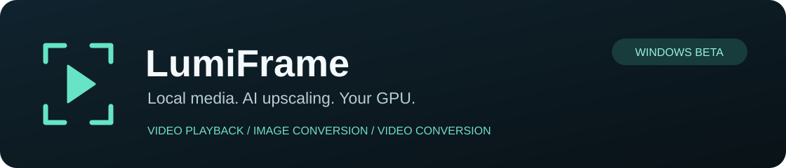

# LumiFrame



**[Download Windows Beta 3](https://github.com/ETONOTE/LumiFrame-Windows/releases/tag/v0.1.0-beta.3)** · [Getting started](#windows-installation) · [Report an issue](https://github.com/ETONOTE/LumiFrame-Windows/issues) · [Roadmap](ROADMAP.md) · [Privacy](PRIVACY.md)

GPU-accelerated video playback and image/video upscaling, with a focus on animation.

LumiFrame combines a local media player with multiple upscaling engines. Choose an engine for your content, set an output resolution, and watch the result during playback or convert a file for later use. Processing runs on your computer or device; media is not uploaded to an upscaling server.

This repository hosts **Windows beta downloads, documentation, and issue reports**, plus Android test information. It is not the application source repository. The Windows interface is currently Korean; this documentation is in English.

## Downloads

| Platform | Version and status | Download or details |
|---|---|---|
| Windows x64 | 0.1.0 Beta 3 — experimental portable release | [Download both required ZIPs](https://github.com/ETONOTE/LumiFrame-Windows/releases/tag/v0.1.0-beta.3) |
| Android | Separate closed-test track | [Earlier Android test notes](ANDROID.md) |

This Windows release does not include an Android APK. The Android document records an earlier test cycle; current Play availability depends on that separate track and tester eligibility.

### Windows installation

Download **both** files:

1. [Application ZIP](https://github.com/ETONOTE/LumiFrame-Windows/releases/download/v0.1.0-beta.3/LumiFrame-Windows-0.1.0-beta.3-win-x64.zip)
2. [Required AI runtime ZIP](https://github.com/ETONOTE/LumiFrame-Windows/releases/download/v0.1.0-beta.3/LumiFrame-Windows-0.1.0-beta.3-tensorrt-runtime.zip)

Extract both into the **same writable folder**, merging their `LumiFrame-Windows` folders. Run **`LumiFrame-Windows/LumiFrame.exe`**. Do not run it inside the ZIP or copy only the executable to another folder.

```text
LumiFrame-Windows/
  LumiFrame.exe          ← open this
  aniedge_convert.exe
  nvinfer_10.dll          ← from the required runtime ZIP
  models/
  shaders/
  licenses/
```

The corresponding-source and GitHub "Source code" archives are **not required to run the app**. [SHA256SUMS.txt](https://github.com/ETONOTE/LumiFrame-Windows/releases/download/v0.1.0-beta.3/SHA256SUMS.txt) contains the download checksums.

For an update, extract into a **new folder** and keep the old version for rollback. The runtime library bytes are unchanged from Beta 2, but a fresh installation still needs both ZIPs. Do not replace individual libraries with unofficial downloads.

### What's new in Beta 3

- Refreshed layout, dark/light themes, playback controls, in-app help and preferences.
- Original/upscaled split comparison available through playback settings.
- Expanded CUGAN input-shape handling and more flexible AI processing height.
- Common video preparation overlap and photo encoding/cleanup overlap, retaining the existing model weights and encoder quality.
- **Anime 6B is conversion-only.** It no longer appears in playback selection or the Auto fallback chain.
- A separate public build excludes development-device identifiers and device-bound experimental execution plans.

The included preparation-overlap change previously reduced a cached V3 60-frame conversion from **2.319 to 2.218 seconds (about 4.4%)** on the reference RTX 4070 SUPER. That is a short-clip result, not a claim of a large long-video speedup. First-use AI preparation can still be lengthy. See the [release notes](https://github.com/ETONOTE/LumiFrame-Windows/releases/tag/v0.1.0-beta.3) for the exact validation scope.

## What you can do

- **Upscaled playback:** choose an engine and a 1080p or 1440p output target while preserving the video's aspect ratio.
- **Player controls:** pause/resume, stop, jump backward or forward, seek with the timeline, adjust volume, capture a frame, and switch fullscreen with F11 / Esc.
- **Preferences:** save playback defaults and transport-display settings.
- **Image conversion:** process a still image and save the result.
- **Video conversion:** process a video for file output instead of live viewing.
- **Manual or Auto selection:** keep the selected engine fixed, or use the supported fallback chain when playback performance requires it.
- **Adjustable AI input:** trade processing cost against retained input detail independently of the final output resolution.

Window size is separate from the internal upscaling target. A windowed player does not mean the output target has been disabled.

## Engines

The engines produce different results; this is **not a universal quality ranking**.

| Engine | Intended use and current considerations |
|---|---|
| Anime4K | Shader-based animation enhancement and the lighter end of the playback fallback chain. Different tradeoffs from a large neural model. |
| E6 / EfRLFN | A lighter neural option used between the selected heavier engine and Anime4K in the Auto chain. |
| AnimeVideo-v3 (V3) | General animation restoration. Can simplify faint lines or ambiguous detail in heavily degraded sources. |
| Hybrid | A combined restoration approach with a different balance of natural and perceptual detail. Compare on your own scenes. |
| CUGAN | An alternative animation model that can separate fine mechanical lines well in some sources. Results vary by scene. |
| Anime 6B | A heavier Real-ESRGAN anime option for **image and video conversion only**. Not a playback engine in Beta 3. |

V3, Hybrid and CUGAN are peer playback options. **Auto uses the selected heavy engine, E6 and Anime4K**; it does not rotate among all peer engines or classify every scene for the best-looking model. File conversion keeps the chosen engine rather than silently substituting a faster model.

## First playback and settings

1. Select a local video.
2. Start with the defaults: **V3 / Auto / 1080p / 360p AI input**.
3. Press Play and allow AI preparation to finish. First-time preparation for an engine, input shape, or GPU can take several minutes. Later runs reuse cached plans.
4. Use Manual mode when comparing a specific engine so Auto does not change the processing path during the comparison.

The AI input setting is not the original video's resolution. For example, a 720p source can be processed at a 360p working height before producing a 1080p output. This reduces processing cost but can discard small details. Raising the final output resolution does not restore information already lost at the input stage.

## Windows requirements and limitations

- Windows x64, an NVIDIA GPU with compatible CUDA and Vulkan drivers, and the Microsoft Visual C++ x64 runtime are required for this package.
- Validation has focused on an **RTX 4070 SUPER**. Other GPUs, clean Windows installations, AMD/Intel AI backends, and broad hardware compatibility are not yet validated.
- This is an **unsigned, experimental beta**. There is no Microsoft Store release or automatic updater yet.
- Performance depends on the engine, AI input size, output size, source cadence, and GPU load. **30 FPS is not guaranteed for every model or video.** Historical development benchmarks are not a certification of this portable release on every machine.
- A 24 FPS source playing at its original cadence is not the same as a 30 FPS source failing to keep up. The app is not advertised as motion interpolation.
- Upscaling estimates missing detail. Small faces, faint marks, compression artifacts, and effects can be smoothed or reconstructed incorrectly; a sharper image is not always a more faithful image.

## Troubleshooting

**Preparation takes a long time:** allow the initial AI plan build to finish. Reusing the same engine and input shape normally avoids repeating the full preparation. Do not delete the cache as a first troubleshooting step.

**The app will not start or reports missing DLLs:** check that both ZIPs were fully extracted into the same folder, and that the GPU driver and Visual C++ runtime are installed. Do not download individual DLLs from unofficial sites.

**Playback is slow or black:** try Anime4K to distinguish basic decoding/display problems from an AI-engine problem. Report the engine, settings, GPU/driver, and whether the issue also occurs with another file. First-time AI preparation and an actual rendering failure are different cases.

**CUGAN input-size error:** Beta 3 expands supported shapes, but extremely large or unusual inputs can still exceed model or GPU limits. Report the source dimensions, chosen AI height and exact error. The source resolution, internal AI dimensions and final output resolution are different settings.

**MP4 cannot preserve the source audio:** try MKV output. Audio is not silently dropped. A previously observed whole-file V3 audio-drain timeout remains a follow-up; bounded passing checks are not a universal stability guarantee.

## Support, privacy, and licenses

[Report a problem](https://github.com/ETONOTE/LumiFrame-Windows/issues) with your platform, app version, GPU/device, selected engine, input/output settings, and reproduction steps. Remove personal paths, account information, and secrets. Do not upload original videos or unreviewed logs; share only material you have permission to publish.

Media processing is local. Opening external links or sending a support report is a separate, user-initiated action. See the [Windows privacy notice](PRIVACY.md). Android's separate [privacy and support policy](https://lumiframe-privacy.etonote.chatgpt.site) is also available.

Third-party terms and notices are included in the app. Matching sources and build recipes for LGPL libraries (FFmpeg, libplacebo, and libiconv) are in the [corresponding-source archive](https://github.com/ETONOTE/LumiFrame-Windows/releases/download/v0.1.0-beta.3/LumiFrame-Windows-0.1.0-beta.3-corresponding-source.zip). These library bytes and their source bundle are unchanged from Beta 2. Upstream projects do not endorse LumiFrame. Use media you own or are authorized to process and share.
