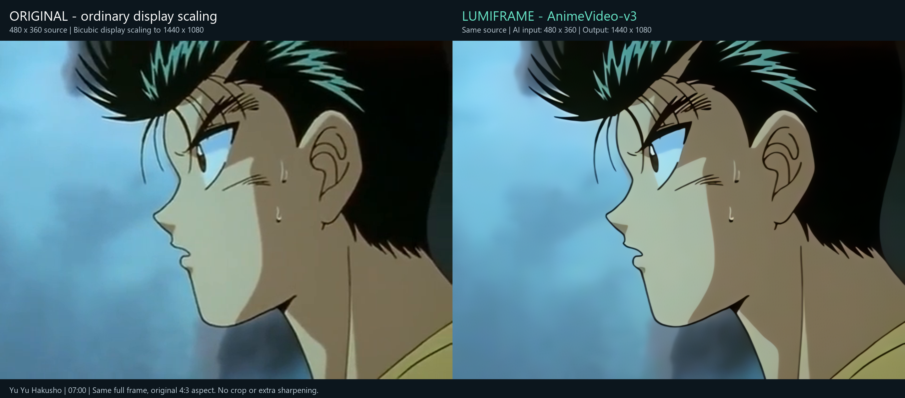

# LumiFrame


**[Download NVIDIA + AMD preview 1.1.0-dev.217](https://github.com/ETONOTE/LumiFrame-Windows/releases/tag/v1.1.0-dev.217)** · [Stable NVIDIA 1.0.0](https://github.com/ETONOTE/LumiFrame-Windows/releases/tag/v1.0.0) · [Getting started](#windows-installation) · [Report an issue](https://github.com/ETONOTE/LumiFrame-Windows/issues) · [Roadmap](ROADMAP.md) · [Privacy](PRIVACY.md)

GPU-accelerated video playback and image/video upscaling, with a focus on animation. Processing runs on your computer; media is not uploaded to an upscaling server.

LumiFrame now integrates NVIDIA and AMD runtimes behind one interface. On first launch, it detects a suitable GPU, measures the available models, and recommends a starting playback model. The Windows interface supports Korean and English; use the language button beside Help.

This repository hosts **Windows downloads, documentation and issue reports**, plus separate Android test information. It is not the application source repository.

## Upscaling example



**Left:** the 480 × 360 source frame enlarged with bicubic display scaling. **Right:** the same frame processed by LumiFrame 1.0.0 with AnimeVideo-v3, using the full 480 × 360 AI input and a 1440 × 1080 output. Both sides retain the original 4:3 aspect ratio; neither is cropped or additionally sharpened.

This scene illustrates cleaner facial and hair outlines, not a universal quality guarantee. Upscaling can also simplify texture or faint detail. The source artwork is from *Yu Yu Hakusho* and belongs to its respective rights holders; it is not licensed as LumiFrame artwork, and no affiliation or endorsement is implied.

## Downloads

| Platform | Status | Download |
|---|---|---|
| Windows x64, NVIDIA or AMD | **1.1.0-dev.217 preview**; AMD physical hardware validation pending | [GPU-specific packages](https://github.com/ETONOTE/LumiFrame-Windows/releases/tag/v1.1.0-dev.217) |
| Windows x64, NVIDIA | Previous stable release, 1.0.0 | [Previous download](https://github.com/ETONOTE/LumiFrame-Windows/releases/tag/v1.0.0) |
| Android | Separate closed-test track; no APK in this Windows release | [Earlier Android test notes](ANDROID.md) |

The AMD integration uses the teammate's [AniEdge for AMD](https://github.com/KORTibetfox/AniEdge-for-AMD) model and DirectML integration. Its upstream project remains separate; the preview above runs inside LumiFrame.

### Windows installation

1. Download the **[common launcher ZIP](https://github.com/ETONOTE/LumiFrame-Windows/releases/download/v1.1.0-dev.217/LumiFrame-Windows-1.1.0-dev.217-launcher-win-x64.zip)**.
2. Download your GPU channel:

| GPU | Required channel downloads |
|---|---|
| AMD | [AMD application, model and runtime](https://github.com/ETONOTE/LumiFrame-Windows/releases/download/v1.1.0-dev.217/LumiFrame-Windows-1.1.0-dev.217-amd-win-x64.zip) |
| NVIDIA | [NVIDIA application and models](https://github.com/ETONOTE/LumiFrame-Windows/releases/download/v1.1.0-dev.217/LumiFrame-Windows-1.1.0-dev.217-nvidia-win-x64.zip) **and** [NVIDIA TensorRT runtime](https://github.com/ETONOTE/LumiFrame-Windows/releases/download/v1.1.0-dev.217/LumiFrame-Windows-1.1.0-dev.217-nvidia-tensorrt-runtime-win-x64.zip) |

3. Extract the launcher and selected channel ZIPs into the **same new writable folder**, merging their `LumiFrame-Windows` folders.
4. Open the top-level **`LumiFrame.exe`**. Keep the entire folder together; do not run it from inside a ZIP.

```text
LumiFrame-Windows/
  LumiFrame.exe                 <- open this
  Update-Channel.ps1
  runtimes/
    amd/                        <- if installed
      current.txt
      1.1.0-dev.217/
    nvidia/                     <- if installed
      current.txt
      1.1.0-dev.217/
```

Install both channels if the launcher should choose between AMD and NVIDIA adapters. Otherwise install the channel for the GPU you intend to use. AMD does not require the NVIDIA downloads. On a mixed-GPU PC, the launcher prefers the eligible adapter with most dedicated VRAM; an explicit `--backend amd` or `--backend nvidia` selects that family if present.

Keep 1.0.0 for rollback. Its flat-folder runtime ZIP cannot substitute for the new channel ZIPs. [SHA256SUMS.txt](https://github.com/ETONOTE/LumiFrame-Windows/releases/download/v1.1.0-dev.217/SHA256SUMS.txt) contains checksums. The corresponding-source and GitHub source-code ZIPs are **not installation packages**.

## What's new

- AMD DirectML CUGAN Denoise x2 joins the existing NVIDIA CUDA/TensorRT engines in the same UI.
- NVIDIA and AMD have separate runtime DLLs, models, saved settings, benchmark results and update versions.
- First-run measurement chooses a starting model from the detected GPU's available engines. Settings can remeasure and apply a recommendation.
- Main/settings window scrolling, resizing and maximize/restore repaint moved controls to fix retained pixels and screen corruption.
- The previous Korean/English interface, playback controls, split comparison and photo/video conversion remain available.

See the [preview release notes](RELEASE_NOTES_217.md) for validation details and limitations.

## First-run model selection

The launcher detects hardware without reading user media. It excludes software adapters and requires DirectX 12 for AMD. Each channel then benchmarks its own engines with a moving synthetic **640 × 360 input → 1920 × 1080 output**.

- Four warm-up frames are excluded; 32–120 frames are measured through actual GPU completion.
- The target is **30 fps**, with spare time for playback: **P95 ≤ 25 ms and P99 ≤ 30 ms**.
- Choose the highest eligible application tier; among peers, choose lower P95. If none meets the budget, choose the fastest successfully measured model. Failed or incomplete candidates cannot win.
- NVIDIA measures Anime4K Fast/Quality, E6, Hybrid, V3 and CUGAN. AMD measures Anime4K Fast/Quality and AMD CUGAN.
- Preparation can take up to 45 seconds per model, bounded to 150 seconds overall. You can skip. The result is saved and reused; GPU, driver, model or runtime changes trigger new measurement.
- Previously saved manual choices are preserved. **Settings → remeasure and automatically select a model** explicitly applies a new recommendation, using Auto / 360p AI input / 1080p output.

This measures a short synthetic workload, not image quality or full video decoding/audio/display performance. It cannot guarantee 30 fps for every video. Live Auto continues to respond to real playback load. [More benchmark details](BENCHMARK.md).

## Engines and playback

| Channel | Engines |
|---|---|
| Both | Anime4K Fast and Quality |
| NVIDIA | E6 / EfRLFN, Hybrid, AnimeVideo-v3, CUGAN; Anime 6B for conversion only |
| AMD | Old-film Denoise Real-CUGAN Pro x2 through DirectML |

V3, Hybrid and NVIDIA CUGAN are peer playback options, not a universal quality ranking. NVIDIA Auto falls back from the selected heavy engine through E6 and Anime4K. AMD Auto uses AMD CUGAN and Anime4K. Auto does not switch among every peer model to classify scenes. File conversion retains the selected engine.

Choose a local video, allow initial model preparation, then play. Pause, seek, adjust volume, capture a frame, or use F11 / Esc for fullscreen. Preferences include original/upscaled split comparison. Photos and videos can also be converted to files.

AI input height is separate from source and output resolution. Processing a 720p source at 360p before producing 1080p lowers cost but can discard detail. Window size is also separate from the upscaling target.

## Updating one GPU channel

Close LumiFrame and extract a newer channel's complete ZIP(s) into a temporary folder. For NVIDIA, combine both NVIDIA archives. Run the installed script against the extracted **version folder**:

```powershell
./Update-Channel.ps1 -PackageFolder "C:/extracted/LumiFrame-Windows/runtimes/amd/NEW-VERSION" -Channel amd
```

Use `-Channel nvidia` for NVIDIA. The installer verifies the full `channel.json` inventory, installs the new version and changes only that channel's `current.txt`. It retains `previous.txt` and old files. Restart to activate. To roll back while closed, copy that channel's `previous.txt` over `current.txt`.

Updates require a new version directory. This script installs local packages; it does not download updates automatically.

## Requirements and known limits

- Windows x64, current Vulkan drivers, and the Microsoft Visual C++ x64 runtime. NVIDIA AI needs a compatible CUDA-capable GPU; AMD needs DirectX 12. Intel-only systems are not supported by this launcher.
- **AMD physical hardware validation is pending.** Both builds and shared policy tests passed on the NVIDIA development host, but AMD drivers, sustained playback and performance still require an AMD PC.
- AMD model inputs require even dimensions and at most 720p area. Use 360p/480p AI height for larger sources. Its GPU inference currently uses CPU transfer buffers.
- This is an unsigned portable preview; it is not a Microsoft Store release. The previous 1.0.0 release remains available.
- First-time AI preparation may be lengthy. GPU memory, input shape and background load affect performance. All-model 30 FPS and large long-video speedups are not promised.
- An earlier whole-file V3 audio-drain timeout remains a compatibility follow-up. Short passing tests do not certify every file.
- Upscaling can smooth or reconstruct faces, fine lines and texture incorrectly. It does not provide motion interpolation or recover guaranteed original detail.

## Troubleshooting

**Missing channel or DLL:** fully extract the launcher and all required channel ZIPs into the same folder. Check the directory layout and GPU family. Do not use the 1.0.0 runtime ZIP in this layout or download individual unofficial DLLs.

**Benchmark skipped or a model failed:** Settings offers remeasurement. Cold model preparation may exceed the bounded test; incomplete candidates are excluded. A manual model selection remains available.

**Slow or black playback:** try Anime4K, reduce AI input height, and compare another file. Report the GPU/driver, model, settings and exact error. First-time preparation and a rendering error are different cases.

**CUGAN input-size error:** reduce AI input height and include the source dimensions in a report. AMD has an explicit 720p-area limit; NVIDIA model bounds vary by shape.

**MP4 cannot preserve audio:** try MKV output. Audio is not silently discarded.

## Support, privacy and licenses

[Report a problem](https://github.com/ETONOTE/LumiFrame-Windows/issues) with the app version, GPU/driver, channel, engine and reproduction steps. Remove personal paths, account information and secrets. Do not upload original videos or unreviewed logs.

Processing and benchmarking are local. No private video is used by the startup benchmark and no benchmark telemetry is uploaded. See [PRIVACY.md](PRIVACY.md). Android has a separate [privacy and support policy](https://lumiframe-privacy.etonote.chatgpt.site).

Third-party terms and notices are included with each channel. AMD model redistribution permission was confirmed by the project owner on October 18, 2026; model bytes are unchanged. Matching sources and build recipes for the unchanged LGPL libraries are in the [corresponding-source archive](https://github.com/ETONOTE/LumiFrame-Windows/releases/download/v1.1.0-dev.217/LumiFrame-Windows-1.1.0-dev.217-corresponding-source.zip). Upstream projects do not endorse LumiFrame. Use media you own or are authorized to process and share.
